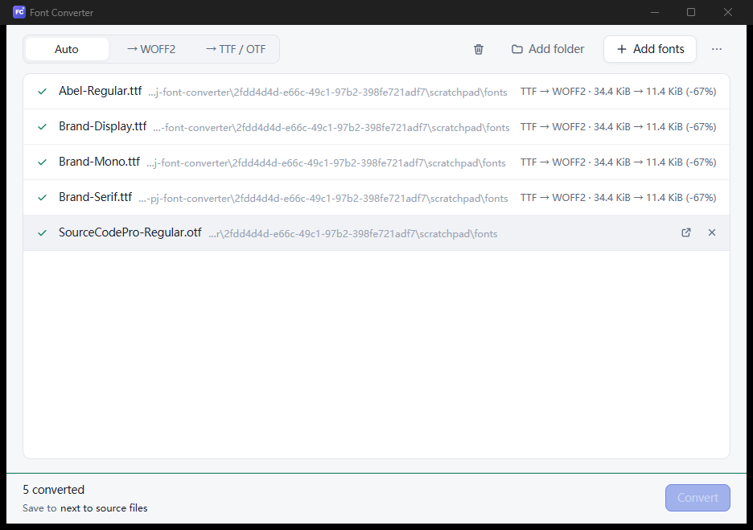
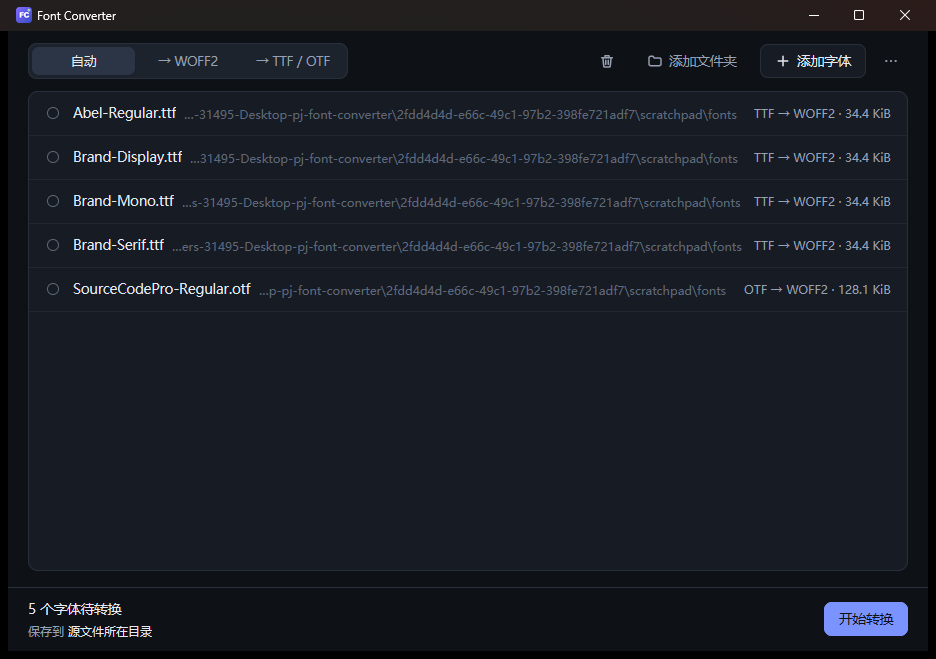

# Font Converter

[English](#english) · [简体中文](#简体中文)

<p align="center">
  
  

</p>

## English

Font Converter is a native **Rust + GPUI** desktop application with an independent CLI. Convert **TTF/OTF ↔ WOFF2** locally using Google WOFF2 and Brotli. WOFF2 decoding chooses TTF or OTF from the font header. WOFF1, collections, outline-format conversion, preview and subsetting are outside the supported feature set.

### Desktop

Add files, add folders recursively, drop files/folders into the window, or pass font paths on the command line (for example "Open with" or dropping fonts onto the executable). The window is a single column: conversion mode and the add buttons on top, the queue in the middle, and the output folder with Convert at the bottom. Existing-output policy, parallelism (1–32), theme and language sit in the ⋯ menu. Each queue row is one line: a status mark, the file name and folder, and the conversion with sizes (or the error); hover for the full path, and use the hover buttons (or Ctrl+R / Delete on the selected row) to show it in its folder or remove it.

Outputs default to the source directory. A selected output directory preserves relative paths beneath each selected input folder. Individually supplied files use their filename. Duplicate inputs are deduplicated; competing outputs and outputs replacing an input are errors. Existing outputs default to skip; error and overwrite are explicit options. Directory symlinks are not traversed.

Cancel stops new work; native codec calls already running finish before the batch ends. Closing a busy window offers continuing or cancelling and exiting after completion. Output is written to a same-directory temporary file and committed only after successful conversion. Limits: 256 MiB input and 128 MiB decompressed WOFF2 output. Encoding uses Brotli quality 11 with font transforms.

English/Chinese, light/dark/system theme, parallelism, conversion mode and existing-output policy persist in versioned `settings.json` in the OS configuration directory (`ProjectDirs`: qualifier `io.github`, organization `mdfox-chaoszone`, application `fontconverter`). Defaults follow system theme and select Chinese for a Chinese system locale, otherwise English. Invalid settings restore defaults with a notice. Queues are session-only.

Shortcuts: Ctrl+O adds files, Ctrl+Shift+O adds folders, Ctrl+Enter starts, Escape cancels, Up/Down/Home/End move the selection, Ctrl+R shows the selected file in its folder, Delete removes it, Tab/Shift+Tab move focus.

### CLI v2

```sh
font-converter-cli ./fonts
font-converter-cli --mode encode -o ./converted --existing skip ./fonts
font-converter-cli --mode decode --jobs 2 ./web-fonts
font-converter-cli --dry-run --json ./fonts
```

Options: `--mode auto|encode|decode`, `-o/--output-dir`, `--existing skip|error|overwrite`, `-j/--jobs 1..32`, `--dry-run`, `--json`, and input paths. Default jobs: min(logical CPU count, 4). Dry-run creates no output files or directories. Ctrl+C safely cancels.

JSON stdout contains one final report with `formatVersion: 2`, `options`, `items`, `warnings`, `summary`, `interrupted`, and `dryRun`. Items contain `id`, `input`, `output`, `inputFormat`, `outputFormat`, `status`, `inputBytes`, `outputBytes`, `errorCode`, and `message`. Enums use snake_case; unavailable optional results are null. Exit codes: **0** success (including skipped outputs), **1** scan/conversion failure, **2** invalid arguments or no convertible input, **130** interrupted.

### Build and test

Requirements: Rust stable (locally validated with Rust 1.97.1), Git submodules and a C/C++ compiler. Windows: MSVC and Windows SDK. macOS: Xcode command-line tools, macOS 15+. Linux: Ubuntu 24.04 libraries below, X11/Wayland graphical session and a working Vulkan driver.

```sh
git submodule update --init --recursive
cargo run --locked -p font-converter
cargo build --locked --release -p font-converter-cli
cargo test --locked --workspace
cargo fmt --all -- --check
cargo clippy --locked --workspace --all-targets -- -D warnings
```

```sh
sudo apt install clang pkg-config libfontconfig-dev libwayland-dev libxkbcommon-x11-dev libx11-xcb-dev libvulkan-dev
```

Pinned OFL fonts and licenses are committed in `tests/fixtures`; missing fonts fail tests. Real round trips are checked with `ttf-parser`: glyph metrics, bounds, character mapping and the name table. WOFF2 normalization means output need not be byte-identical to the original font.

### Packaging

Run on the target OS with Python 3.11+ (packaging only; not an application dependency):

```sh
python packaging/package.py --target x86_64-pc-windows-msvc
# Already built locally without --target:
python packaging/package.py --target x86_64-pc-windows-msvc --skip-build --binaries-dir target/release
```

Output: `dist/<target>`, with checksums and build metadata. Windows x64/ARM64: portable EXE/ZIP. Linux x64/ARM64: AppImage, DEB, RPM (Ubuntu 24.04 baseline; system libraries and GPU drivers required). macOS Apple Silicon: APP ZIP/DMG. Each target has a separate CLI archive. Linux packaging needs `dpkg-deb`, `rpmbuild` and `APPIMAGETOOL` pointing to appimagetool 1.9.1. macOS uses `ditto`, `codesign` and `hdiutil`; optional `APPLE_SIGNING_IDENTITY` and `APPLE_NOTARY_PROFILE` enable Developer ID signing and notarization. Without credentials macOS uses an ad hoc signature and is not notarized. Windows packages are unsigned unless signed separately.

CI covers all five targets. Tag-triggered automation builds a draft release after successful builds. Local verification is Windows x64; other platforms require their own CI and runtime evidence. See [VALIDATION.md](VALIDATION.md).

### Architecture and licenses

- `engine`: font detection, scan/planning, native codec, atomic writes, cancellable workers.
- `desktop`: GPUI window with self-drawn controls (no component library), virtualized queue, native dialogs, settings and localization.
- `cli`: Clap and JSON v2, sharing the engine without GPUI dependencies.
- `vendor`: pinned Google WOFF2 and Brotli submodules.
- `packaging`: independent native packaging.

Application: [MIT](LICENSE). Third-party notices: [THIRD_PARTY_LICENSES](THIRD_PARTY_LICENSES); additional full licenses in `licenses/`. The desktop depends directly on the published GPUI snapshot (`gpui-pre` / `gpui-pre-platform` 0.3.9, pinned).

## 简体中文

Font Converter 是基于 **Rust + GPUI** 的原生桌面应用，另提供独立 CLI。使用 Google WOFF2 与 Brotli 在本地完成 **TTF/OTF ↔ WOFF2** 双向转换；解码时根据字体头自动选择 TTF 或 OTF。

### 使用

添加文件、递归添加文件夹、拖入文件/文件夹，或通过命令行传入字体路径（如“打开方式”或把字体拖到程序图标上）。界面为单栏：顶部是转换方向和添加按钮，中间是队列，底部是保存位置和“开始转换”。已有输出策略、并行数（1–32）、外观和语言放在“⋯”菜单中。队列每个任务占一行：状态标记、文件名与所在目录、转换方向与大小（失败时显示错误）；悬停可查看完整路径，并可通过悬停按钮（或对选中项按 Ctrl+R / Delete）打开所在位置或移出队列。

默认输出到源文件旁；指定目录时保留各输入文件夹的相对路径，单独添加的文件使用文件名。重复输入去重，输出冲突或覆盖输入均报错，不自动改名。已有输出默认跳过，可明确选择报错或覆盖。不递归进入目录符号链接。

取消停止派发后续任务，正在运行的原生编解码完成后收尾。运行时关闭窗口可选择继续运行或取消后退出。输出使用同目录临时文件，成功后才提交，失败不会留下半成品。输入上限 256 MiB，WOFF2 解码输出上限 128 MiB；编码使用 Brotli quality 11 和字体变换。

支持中英切换、系统/浅色/深色主题。语言、主题、并行数、转换方向和已有输出策略保存到系统配置目录内的版本化 JSON；首次按系统语言选择中英并跟随系统主题。配置损坏时提示并恢复默认值；不保存任务历史。快捷键：Ctrl+O 添加文件，Ctrl+Shift+O 添加文件夹，Ctrl+Enter 开始，Escape 取消，上/下/Home/End 移动选中项，Ctrl+R 打开选中文件所在位置，Delete 将其移出队列，Tab/Shift+Tab 切换焦点。

不支持 WOFF1、字体集合、预览、子集化或 TTF 与 OTF 相互转换。

### CLI、构建和交付

参数及命令见上方对应章节。默认并行数为逻辑线程数与 4 的较小值，可选择 1–32。`--dry-run` 只扫描和规划，不创建输出文件或目录；Ctrl+C 安全取消。

JSON 报告为 `formatVersion: 2`，包含选项、任务、警告、统计、中断和 dry-run 标识。退出码：0 成功（含跳过），1 扫描/转换失败，2 参数错误或无可转换输入，130 用户中断。

需要 Rust stable、Git 子模块和 C/C++ 工具链。Windows 使用 MSVC 和 Windows SDK；macOS 需要 15+ 和 Xcode 命令行工具；Linux 使用 Ubuntu 24.04 构建基线，运行需要 X11/Wayland 和 Vulkan 驱动。真实测试字体及 OFL 许可证已随仓库提供，缺失时测试失败。

桌面启动：`cargo run --locked -p font-converter`。CLI 编译：`cargo build --locked --release -p font-converter-cli`。完整测试：`cargo test --locked --workspace`。CLI 单独构建不会引入 GPUI。

打包脚本需要 Python 3.11+，应用运行不依赖 Python。Windows 提供便携 EXE/ZIP；Linux x64/ARM64 提供 AppImage、DEB、RPM；macOS Apple Silicon 提供 APP/DMG，各平台独立提供 CLI 归档、校验值和构建元数据。Linux 仍需系统库和 GPU 驱动；macOS 未配置签名/公证时仅使用临时签名，Windows 默认未签名。

已配置五个平台的 CI 和标签触发的草稿发布流程。本地验证以 Windows x64 为准，其他平台需各自取得构建与运行证据。实际结果见 [VALIDATION.md](VALIDATION.md)。源码使用 [MIT](LICENSE)，第三方声明见 [THIRD_PARTY_LICENSES](THIRD_PARTY_LICENSES)。

## 支持与赞助

如果这个项目对你有帮助，欢迎给这个项目点心。任何赞助都不胜感激哦。

### 微信支付与支付宝

| 微信支付 | 支付宝 |
| :---: | :---: |
|  |  |
### USDT

- Plasma：`0x742fa2ac27c5d3ff0c337b93ad688d39a77da4c8`
- Aptos：`0xb3ba1611884cc1c2d2d970d081f6c24089d363817a772bddab52a0a278c6ffef`

| Plasma | Aptos |
| :---: | :---: |
|  |  |

转账 USDT 时，请同时核对网络和钱包地址。
